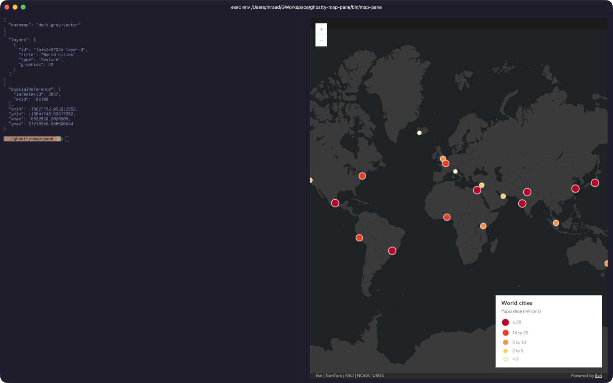
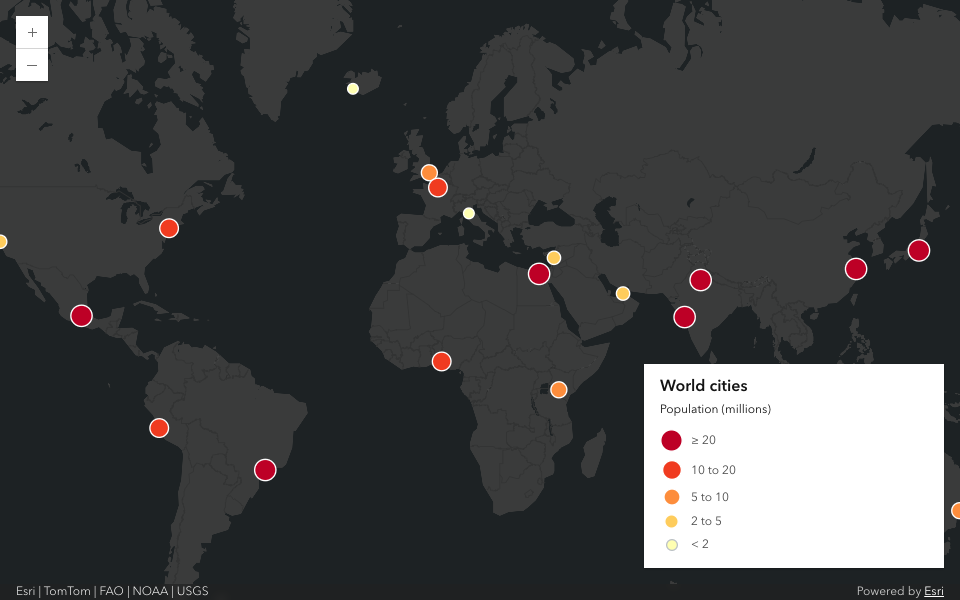

# map-pane

A live web map that an agent drives from the terminal. The map is built on the ArcGIS Maps SDK for JavaScript 5.2.2.
Headless Chrome draws the map. A terminal pane shows it, and takes your mouse and keys.

You can use it in two ways. Both drive the same map:

| Use | Agent | Pane | Guide |
|---|---|---|---|
| Claude Code mod | Claude Code (tools `mcp__mappane__*`, command `/map`) | Claude Code side pane, or a browser window | [docs/mod.md](docs/mod.md) |
| Standalone | Codex, Pi, Claude Code, or you (the `map-pane` skill and `mappane/bin/map-command`) | Ghostty split (Kitty graphics), or any browser | [docs/standalone.md](docs/standalone.md) |



## What the map does

- Adds data: GeoJSON (file, URL or inline), GeoPackage, GeoParquet, CSV, feature services, map services, tile, vector tile and imagery layers, and portal items.
- Styles data: renderers, labels and filters. GeoJSON with one geometry type gets a legend entry and popups.
- Moves the view: to a place or address (geocoded), to coordinates, or to a layer.
- Changes the basemap: keyless basemaps, all legacy ids, and basemap styles after a sign-in.
- Signs in to a portal (OAuth with PKCE) and saves the map as a private web map item.
- Saves a PNG screenshot.

The legend shows at the bottom right while the map has layers. It hides when the map is empty.



## Requirements

- macOS, Node.js 24 or later, and Google Chrome. No npm packages.
- Network access to `js.arcgis.com` and to the basemap tile servers.
- Mod: Claude Code v2.1.287 or later.
- Ghostty split: Ghostty 1.4 or later.

## Quick start

Claude Code mod:

```
/plugin install mappane --marketplace mraad/map-pane
/map
```

Then ask Claude, for example: "go to Kuwait City and add examples/cities.geojson".

Standalone, from the repository folder:

```sh
mappane/bin/map-pane --split                       # open the map in a Ghostty split
mappane/bin/map-command go_to location 'Paris, France'
mappane/bin/map-command graphics examples/cities.geojson --title Cities --renderer examples/population-renderer.json
```

Codex: `codex exec -s workspace-write -c sandbox_workspace_write.network_access=true '$map-pane go to Austin, Texas'`.
Pi: `/skill:map-pane go to Austin, Texas`.

## One map, many doors

```
Claude Code mod ──TCP + token──┐
                               ├──> bridge (mappane/web/server.mjs) ──SSE──> every open map page
bin/map-command ──Unix socket──┘          keeps a log, replays it              (mod pane, Ghostty pane, browser)
```

The bridge keeps a log of the map changes and replays it to each page that opens.
All pages show the same map. With the mod running, the CLI and the skill drive the mod's map.
Details: [docs/architecture.md](docs/architecture.md).

## Test

```sh
npm test                          # every suite (some need Chrome and network access)
claude plugin validate mappane
claude plugin test mappane        # the mod's hooks
```

## History

This repository replaces two repositories, which are now deprecated:
`mraad/claude-mod-map` (the Claude Code mod) and `mraad/ghostty-map-pane` (the Ghostty pane and CLI).

## License

MIT. ArcGIS is a trademark of Esri. This project is not affiliated with Esri.
