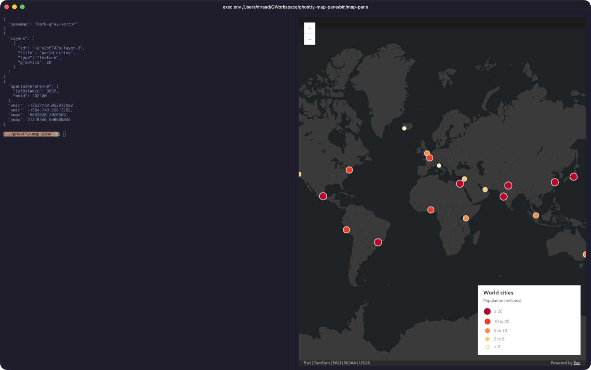
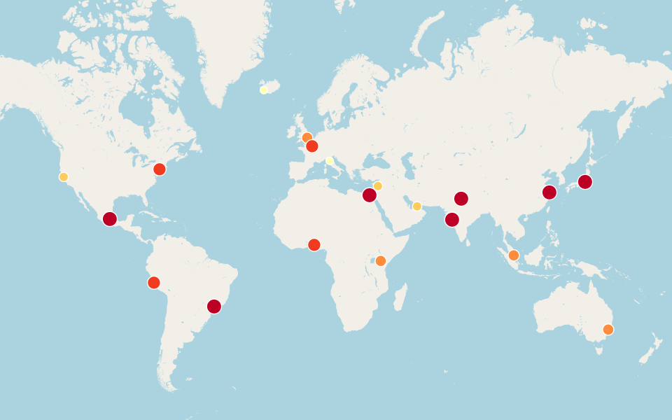
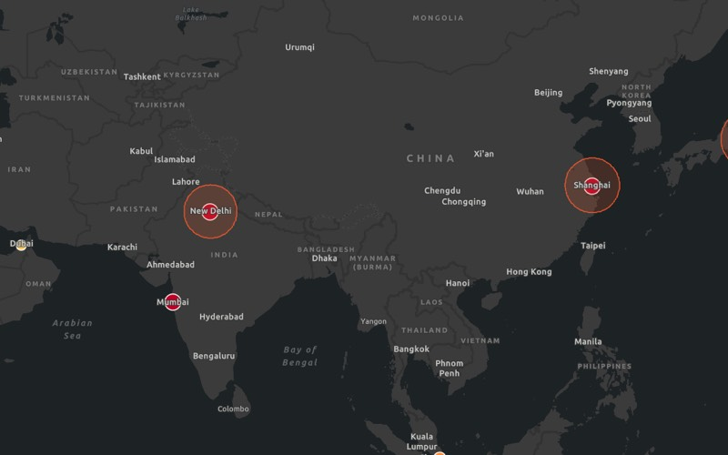

# map-pane: one live map for Claude Code, Codex and Pi

<!-- Published: https://thunderheadxpler.blogspot.com/2026/11/map-pane-one-live-map-for-claude-code.html -->

I work most of the day in a terminal with a coding agent. When the work is spatial, I want to see the result on a map. I do not want to leave the terminal, and I do not want to write a web app first.

map-pane is my answer. It is a live web map that an agent drives from the shell. The map uses the ArcGIS Maps SDK for JavaScript 5.2.2. Headless Chrome draws the map, and a terminal pane shows it. The pane also takes your mouse and keys, so you can pan and zoom by hand while the agent works.



The code is at [github.com/mraad/map-pane](https://github.com/mraad/map-pane), MIT licensed. It needs macOS, Node.js 24 and Google Chrome. It has no npm dependencies. I want to keep it that way.

## What it does

The agent can do these things on the map:

- Add data: GeoJSON (file, URL or inline), GeoPackage, GeoParquet, CSV, feature services, map services, tile and vector tile layers, and portal items.
- Style data: renderers, labels and filters. GeoJSON with one geometry type gets a legend entry and popups.
- Move the view: to a geocoded place or address, to coordinates, or to a layer.
- Change the basemap.
- Sign in to a portal and save the map as a web map item.
- Write a PNG screenshot.
- Run JavaScript in the map page, when no command does the job.

The map shows in a Ghostty split or in any browser tab. Both show the same map at the same time.

## How it works

There are three parts:

- **The bridge** (`mappane/web/server.mjs`). This is one Node process. It keeps a log of every change to the map.
- **The map pages** (`index.html` and `app.js`). Any number of pages can be open. Each page reads commands from the bridge over Server-Sent Events (SSE) and runs them one at a time.
- **The CLI** (`mappane/bin/map-command`). It turns a command line into an `{op, args}` message and sends it to the bridge over a Unix socket.

```
skill ──> bin/map-command ──Unix socket──> bridge (server.mjs) ──SSE──> every open map page
                                            keeps a log, replays it       (Ghostty pane, browser)
```

The log is the important part. When a page opens or reconnects, the bridge sends it the full log. The page then shows the same map as the other pages. The bridge also gives each new layer an id (`L1`, `L2` and so on). A layer has the same id on every page, so `remove L2` removes the same layer everywhere.

Not every command goes into the log. A command that only reads the map or moves the view is not logged. Examples are `go_to`, `extent` and `screenshot`. A sign-in token is never logged and never written to disk.

The Ghostty pane is a small Node program. It runs headless Chrome over the DevTools protocol, takes the screencast frames and writes them to the terminal with the Kitty graphics protocol. So the pane shows real pixels, not characters. Mouse and key events go back to Chrome the same way.

## Drive it from the shell

The agent uses the same commands that you type. Open the map in a Ghostty split:

```sh
mappane/bin/map-pane --split
```

Then send commands from another terminal:

```sh
mappane/bin/map-command go_to location 'Paris, France'
mappane/bin/map-command graphics examples/cities.geojson --title Cities --renderer examples/population-renderer.json
mappane/bin/map-command update-layer Cities --filter 'population__millions_ > 10'
mappane/bin/map-command screenshot /tmp/cities.png
```

Each command prints JSON. A failed command prints the error and exits with status 1. The agent reads that JSON, so it knows the layer id, the geocoder match or the error.


Renderers, labels and symbols use the SDK's autocast JSON. The agent writes the same JSON that it finds in the SDK documentation. There is no second schema to learn.

## One skill, three agents

The CLI is the whole interface. A skill (`.agents/skills/map-pane`) teaches the CLI syntax to the agent. Claude Code, Codex and Pi all read the same skill.

Claude Code:

```
/plugin install map-pane --marketplace mraad/map-pane
/map-pane:map-pane go to Kuwait City and add examples/cities.geojson
```

Codex:

```sh
codex plugin marketplace add mraad/map-pane && codex plugin add map-pane@map-pane
codex exec -s workspace-write -c sandbox_workspace_write.network_access=true '$map-pane go to Austin, Texas'
```

Pi:

```sh
pi install git:github.com/mraad/map-pane
pi -p '/skill:map-pane go to Austin, Texas'
```

I gave the same task to the three agents: open the map, go to a city, add the cities layer with a renderer, and take a screenshot. These are their screenshots, from left to right: Claude Code, Codex and Pi.

  

The first version also had a Claude Code mod with its own tools and a side pane. In version 0.5.0 I removed it. Two interfaces to the same map were twice the work, and the skill does the same job for every agent.

## When the commands are not enough

Fixed commands cover the common work. They do not cover a statistics query, a renderer calculated from the data, or a buffer. For that, the agent can send JavaScript to the map page:

```sh
mappane/bin/map-command js query.js --read-only
```

The code is the body of an async function. It gets `view`, `map`, `layerId` and an `AbortSignal`. It loads SDK modules with `$arcgis.import`. The return value comes back as JSON, with the `console` lines. A throw comes back as an error, so the agent can correct the code and try again.

This example makes 300 km geodesic buffers around the three largest cities:

```js
const [GraphicsLayer, Graphic, buffer] = await $arcgis.import([
  "@arcgis/core/layers/GraphicsLayer.js",
  "@arcgis/core/Graphic.js",
  "@arcgis/core/geometry/operators/geodesicBufferOperator.js",
])
await buffer.load()
const cities = map.layers.find(l => l.title === "Cities")
const { features } = await cities.queryFeatures({
  where: "1=1", orderByFields: ["population__millions_ DESC"], num: 3, outFields: ["name"], returnGeometry: true,
})
const rings = new GraphicsLayer({ id: layerId, title: "300 km around the 3 largest cities" })
const symbol = { type: "simple-fill", color: [228, 87, 46, 0.2], outline: { color: "#e4572e", width: 1 } }
for (const f of features) {
  rings.add(new Graphic({ geometry: buffer.execute(f.geometry, 300, { unit: "kilometers" }), symbol, attributes: f.attributes }))
}
map.add(rings)
return { layerId, rings: rings.graphics.length, cities: features.map(f => f.attributes.name) }
```



Two rules make this work with the log:

- Code that changes the map is logged, like any other command. Each new page runs it again. So the code must give the same result on a new page, and a new layer must use the `layerId` that the bridge gives.
- Code that only reads gets `--read-only`. It is not logged and does not run again.

Code that blocks the page (an endless loop) gets no answer. After 65 s the bridge drops it from the log, so a new page does not freeze on it too.

The e2e suite runs every code block in `docs/run-js.md` in order. If I break an example, the tests tell me.

## Sign in and save a web map

The map works without a sign-in. Basemap styles, private portal items and web map saves need one:

```sh
mappane/bin/map-command login --client-id <your-client-id>
mappane/bin/map-command save-webmap 'World cities'
```

`login` runs an OAuth flow with PKCE in the CLI and sends the token to the map pages. The bridge keeps the last token in memory and sends it first to each new page. It never writes it to the log or to disk. The pages renew the token before it expires.

If you already use arcctl, `login --arcctl` takes its session instead. map-pane only reads the arcctl config file. It refuses a file that other users can read, and it sends the token only to the portal that issued it.

`save-webmap` saves a private web map item. A layer that the bridge serves from a local file cannot go into a web map, because that URL stops working when the bridge stops. The command refuses such a layer before it creates the item.

## Security on a local machine

The bridge listens only on `127.0.0.1`. That is not enough by itself, because a web page in your browser can also send requests to `127.0.0.1`. So the bridge also does these things on TCP:

- It accepts only the `Host: 127.0.0.1:<port>` header. This stops DNS rebinding.
- It refuses a foreign `Origin` and a cross-site `Sec-Fetch-Site`. This stops a cross-site POST.
- When `MAP_PANE_TOKEN` is set, the control endpoints need the `x-map-pane-token` header.

The Unix socket skips these checks. The socket has mode 0600 in an owner-only folder, and the CLI refuses a folder that another user owns.

`run_js` is not a sandbox. The code runs as the page. After a sign-in, it can read the token and send it to any server. Feature attributes and item titles can carry instructions to the agent. So the risk case is a signed-in map with data that you do not trust. The docs say this, and I say it here: do not sign in when you load data that you do not trust.

I also assume a single-user machine. A browser cannot send a token on an SSE connection, so `/events` is open on TCP. Another account on the same computer could read the map. Do not run it on a shared computer.

## Things that surprised me

**The SDK pads the extent of one point.** In SDK 5.2, `queryExtent()` on a client-side layer with one point returns a padded extent in metres, but labels it WGS84. A zoom to that layer went to latitude 0. The fix is in one function, `extentOf`. When the query finds one feature, it uses the feature's geometry instead of the extent.

**The CDN reports a different version.** The SDK loads from the `5.2.2` URL, but `kernel.fullVersion` says `5.2.1`. The tests check the load URL instead.

**Most layers have no `clone()` in SDK 5.2.** My first `save-webmap` copied the layers into a new WebMap and failed on most of them. Now it saves a WebMap with only the basemap, then writes each layer's `toJSON()` into the item data.

**Chrome tests are timing-sensitive.** A test that clicks the zoom button failed under load. Now it waits for `view.stationary` before it compares the zoom levels. `npm test` runs one file at a time.

## Try it

Clone the repository and open the map:

```sh
git clone https://github.com/mraad/map-pane.git
cd map-pane
mappane/bin/map-pane --split
```

No Ghostty? Use `mappane/bin/map-pane --browser`. Then add `examples/cities.geojson` with a renderer. After that, ask your agent to do the same.

The docs have the details: [standalone.md](https://github.com/mraad/map-pane/blob/main/docs/standalone.md) for the CLI and the agents, [run-js.md](https://github.com/mraad/map-pane/blob/main/docs/run-js.md) for JavaScript in the map, and [architecture.md](https://github.com/mraad/map-pane/blob/main/docs/architecture.md) for the protocol and the security rules.

*ArcGIS is a trademark of Esri. This project is not affiliated with Esri.*
