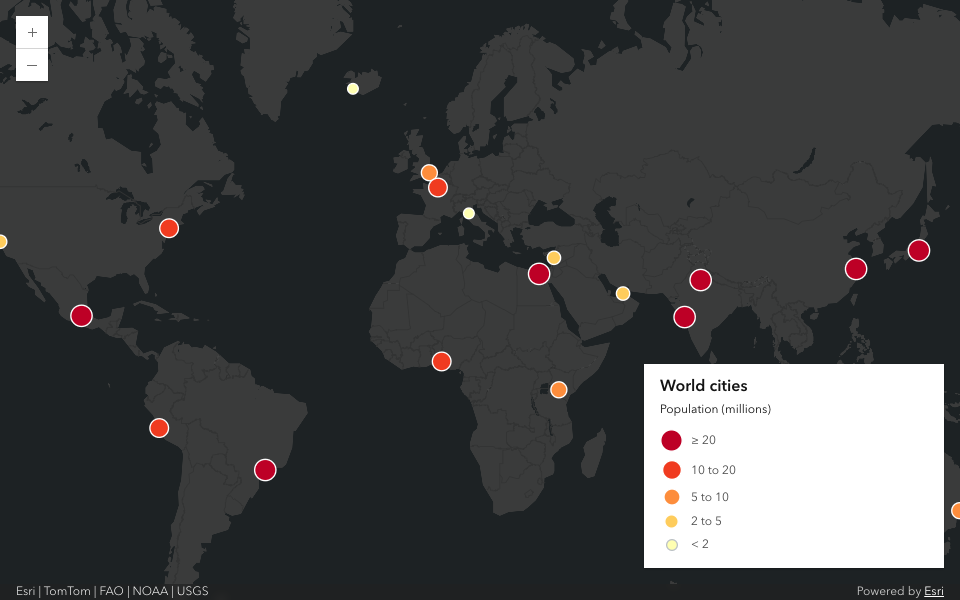
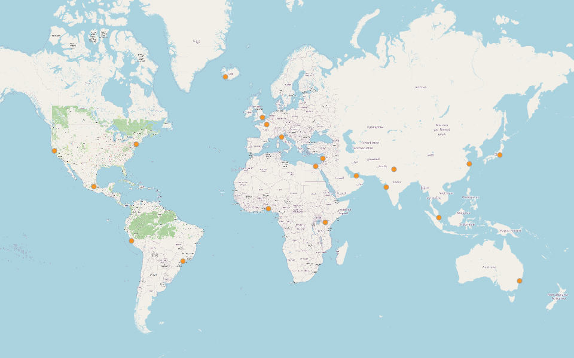

# map-pane: a live map that any coding agent can drive

I spend most of my day in a terminal with a coding agent. When the work is spatial, I want to see the result on a map. I do not want to leave the terminal to look at it, and I do not want to write a web app first.

So I built map-pane. It is a live web map that an agent drives from the terminal. The map uses the ArcGIS Maps SDK for JavaScript 5.2.2. Headless Chrome draws the map. A terminal pane shows it and takes your mouse and keys. The agent tells it what to do: go to a place, add a layer, change a renderer, take a screenshot.


The code is at [github.com/mraad/map-pane](https://github.com/mraad/map-pane). It is MIT licensed. It needs macOS, Node.js 24 and Google Chrome. It has no npm dependencies.

## Two projects became one

I started with two separate projects. The first was a Claude Code mod. It gave Claude tools such as `add_layer` and `go_to`, and it showed the map in the Claude Code side pane. The second was a Ghostty split with a CLI. Any agent with a shell could drive it: Codex, Pi or Claude.

Both projects did the same job. Both used port 8765, so they could not run at the same time. Each one had features that the other did not have. The mod had GeoParquet, CSV, portal items and a session log. The Ghostty version had GeoPackage, portal sign-in, geocoding and a better legend.

I merged them into one repository. The mod's bridge became the core, because it already had replay, authentication and file serving. The Ghostty project supplied the page layout, the legend, the Kitty pane and the CLI. Now one map serves all agents.

## One map, many doors

The design has three parts:

- **The bridge** (`mappane/web/server.mjs`). This is one Node process. It keeps a log of every change to the map.
- **The map page** (`web/index.html` and `app.js`). Any number of pages can be open. Each page reads commands from the bridge over Server-Sent Events (SSE) and runs them one at a time.
- **The callers.** The Claude Code mod talks to the bridge over TCP with a token. The CLI talks to it over a Unix socket.

```
Claude Code mod ──TCP + token──┐
                               ├──> bridge (server.mjs) ──SSE──> every open map page
bin/map-command ──Unix socket──┘    keeps a log, replays it       (mod pane, Ghostty pane, browser)
```

The log is the important part. When a page opens or reconnects, the bridge sends it the full log. The page then shows the same map as all the other pages. The bridge also gives each layer an id (`L1`, `L2` and so on), so a layer has the same id on every page.

Not every command goes into the log. A command that only moves the view or reads the map is not logged. Examples are `go_to`, `screenshot` and `extent`. A sign-in token is never logged and never written to disk. The bridge keeps the last token in memory and sends it first to each new page.

## Use it as a Claude Code mod

Install the plugin from the marketplace:

```
/plugin install mappane --marketplace mraad/map-pane
```

Type `/map` to open the map in the side pane. Then ask Claude in plain language:

- "Go to Kuwait City."
- "Add examples/cities.parquet as a layer and color it by population."
- "Filter the Cities layer to population over 10 million."
- "Take a screenshot of the map."


The mod gives Claude twelve tools with the prefix `mcp__mappane__`. These include `add_layer`, `update_layer`, `add_geopackage`, `go_to` and `save_webmap`. Renderers, symbols and labels use the SDK's autocast JSON, so Claude writes the same JSON that you find in the SDK documentation.

The mod saves the map for each Claude Code session in `~/.claude/map-pane/sessions/`. When you resume a session, the map comes back.

## Use it standalone with Codex, Pi or Claude

The standalone version is a skill and a CLI. The skill teaches the agent the CLI syntax. The agent then runs shell commands.

You can also run the commands yourself:

```sh
mappane/bin/map-pane --split
mappane/bin/map-command go_to location 'Paris, France'
mappane/bin/map-command graphics examples/cities.geojson --title Cities --renderer examples/population-renderer.json
```

The first command opens the map in a Ghostty split. The pane uses the Kitty graphics protocol, so it shows real pixels in the terminal. The second command geocodes an address and moves the map. The third command adds a GeoJSON file with a class-breaks renderer.



GeoJSON with one geometry type becomes a client-side feature layer. It gets a legend entry and popups. The legend shows at the bottom right while the map has layers, and it hides when the map is empty.

To install the skill in Codex:

```sh
codex plugin marketplace add mraad/map-pane && codex plugin add map-pane@map-pane
codex exec -s workspace-write -c sandbox_workspace_write.network_access=true '$map-pane go to Austin, Texas'
```

To install it in Pi:

```sh
pi install git:github.com/mraad/map-pane
pi -p '/skill:map-pane go to Austin, Texas'
```

I gave the same task to all three agents: open the map, go to a city, add the cities layer with a renderer, and take a screenshot. These are the screenshots from Claude, Codex and Pi.

  

The mod and the CLI can run at the same time. When the mod's bridge runs, the CLI finds its socket and drives the same map. Claude and Codex can work on one map together.

## Security on a local machine

The bridge listens only on `127.0.0.1`. That is not enough by itself, because a web page in your browser can also send requests to `127.0.0.1`. So the bridge does three more things:

- It accepts only the `Host: 127.0.0.1:<port>` header. This stops DNS rebinding.
- It refuses a request from a foreign `Origin`. This stops a cross-site POST.
- The control endpoints (`/cmd`, `/input` and `/clear`) need the `x-map-pane-token` header. The mod makes a new random token each time it loads.

The Unix socket skips these checks. The socket file has mode 0600, so only its owner can connect to it.

There is one accepted limit. The map page cannot send a token on its SSE connection, so `/events` is open on TCP. Another user account on the same computer could read the map. I assume a single-user machine, and the docs say so.

## Things that surprised me

**The SDK pads the extent of one point.** In SDK 5.2, `queryExtent()` on a client-side layer with one point returns a padded extent in metres, but labels it WGS84. A zoom to that layer went to latitude 0. The fix is in one function, `extentOf`. When the query finds one feature, it uses the feature's geometry instead of the extent.

**The CDN reports a different version.** The SDK loads from the `5.2.2` URL, but `kernel.fullVersion` says `5.2.1`. The tests check the load URL instead.

**Chrome tests are slow and timing-sensitive.** A test that clicks the zoom button failed under load. Now it waits for `view.stationary` before it compares the zoom levels. `npm test` runs the Chrome suites one file at a time.

## Try it

Clone the repository and open the map:

```sh
git clone https://github.com/mraad/map-pane.git
cd map-pane
mappane/bin/map-pane --split
```

Then add `examples/cities.geojson` and give it a renderer. After that, ask your agent to do the same.

The docs have the details: [docs/mod.md](https://github.com/mraad/map-pane/blob/main/docs/mod.md) for the mod, [docs/standalone.md](https://github.com/mraad/map-pane/blob/main/docs/standalone.md) for Codex and Pi, and [docs/architecture.md](https://github.com/mraad/map-pane/blob/main/docs/architecture.md) for the protocol and the security rules.

*ArcGIS is a trademark of Esri. This project is not affiliated with Esri.*
