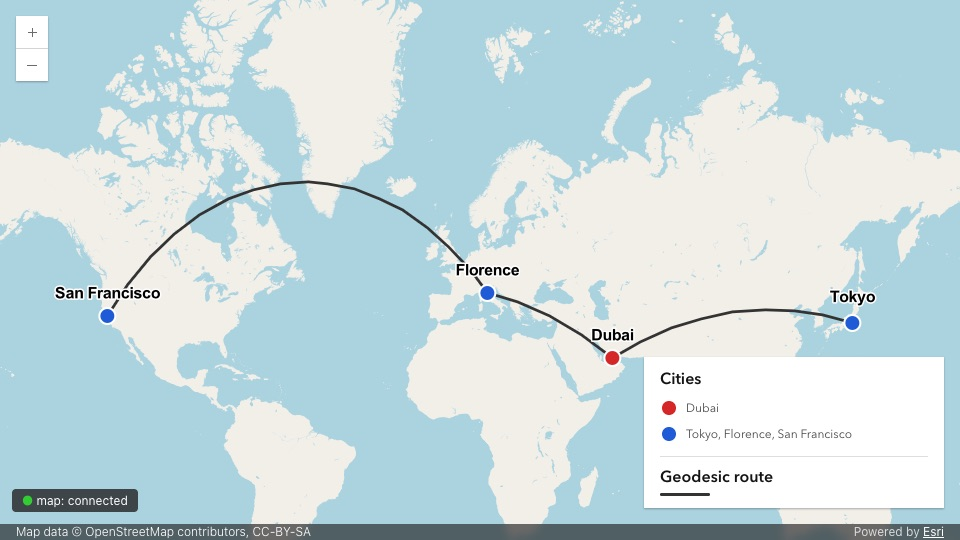

# Code mode and the library

map-pane has two ways in besides the shell:

- **Claude Code code mode.** Claude writes JavaScript and runs it in the REPL tool. A script calls `map-command` through `$`, chains many map commands and reads each JSON result in one turn.
- **Node library.** Node code imports `run` and `connect` from `mappane/cli/command.mjs` (package export `map-pane`) and calls the map without a child process.

Both use the same commands, words and results as the CLI ([standalone.md](standalone.md#5-map-commands)). The CLI is a printer over `run()`: what `map-command` prints is the JSON form of what `run` returns.

## Contents

1. [Which way to use](#1-which-way-to-use)
2. [Code mode in Claude Code](#2-code-mode-in-claude-code)
3. [The map helper](#3-the-map-helper)
4. [Arguments, files and JSON](#4-arguments-files-and-json)
5. [Recipes](#5-recipes)
6. [Worked example: four cities and a geodesic route](#6-worked-example-four-cities-and-a-geodesic-route)
7. [Node library reference](#7-node-library-reference)
8. [Errors, timeouts and retries](#8-errors-timeouts-and-retries)
9. [Security](#9-security)
10. [Troubleshooting](#10-troubleshooting)

## 1. Which way to use

| Caller | Use | Why |
|---|---|---|
| Claude Code with code mode (`REPL` tool) | `$` + `map-command` (the helper below) | The REPL is sealed: no `import`, `require`, sockets or network. The shell is its only way out. |
| Claude Code without code mode, Codex, Pi | `map-command` in the shell tool | One command per tool call, as in the skill. |
| Node scripts, Pi extensions, tests, other tools | `import { run, connect } from "map-pane"` | No child process per command, real exceptions, results as objects. |
| Shell scripts, people | `mappane/bin/map-command` | Unchanged. |

## 2. Code mode in Claude Code

In code mode Claude has one tool, `REPL`. It runs JavaScript in a persistent context. Each REPL call is a full model round trip, but the work inside one script is cheap. So one script should do all the map work that does not need a decision in between: open or find the map, add data, style it, zoom, take a screenshot, and check the results.

What the REPL has and does not have:

| Has | Does not have |
|---|---|
| `$` (shell commands; resolves stdout, exit code) | `import`, `require`, `process` |
| `write(path, text)`, `file(path).text()` | sockets, `fetch` to the bridge |
| `Read({file_path})` to look at a PNG | the `map-pane` module |
| variables that last between calls | |

So code mode calls the CLI, and the CLI talks to the bridge over its Unix socket.

### Where the scripts are

Call the CLI by its absolute path in the skill folder:

- Clone, skill found through `.claude/skills/map-pane`: `<clone>/.agents/skills/map-pane/scripts/map-command` (`.claude/skills/map-pane/scripts/map-command` is the same file).
- Installed plugin: the skill's base directory, which Claude Code shows when the skill loads, plus `/scripts/map-command`.
- Or the runtime itself: `<clone>/mappane/bin/map-command`.

Run it from the user's working folder: relative file arguments (`./f.geojson`, `./map.png`) resolve there. In the REPL, `$` runs in Claude Code's working folder.

### Permissions

In a permission mode that asks, every `$` call asks once per new command. Allow the CLI one time in `/permissions`, for example `Bash(/path/to/map-pane/.agents/skills/map-pane/scripts/map-command:*)`. In a mode that asks, each REPL call also waits for its script to end.

## 3. The map helper

Define it once. It lasts for the session (until a REPL restart).

```js
const S = "/path/to/map-pane/.agents/skills/map-pane/scripts"
// parse: a map-command result as its JSON (plain text for --help), or its error thrown. map: one call.
const parse = (r) => {
  if (r.exitCode) throw new Error(r.stdout.trim())
  const out = r.stdout, start = out.search(/^[[{]/m) // stderr is merged: skip notes (login URL) before the JSON
  return start < 0 ? out : JSON.parse(out.slice(start))
}
const map = async (...argv) => parse(await $`${S}/map-command ${argv}`.nothrow())
```

Why each line is there:

- `${argv}`: `$` quotes each item of an array as one shell argument. Place names with spaces, inline JSON and SQL filters arrive as one argument each, with no shell escaping. Numbers become strings (`35.68` is the argument `35.68`).
- `.nothrow()`: `map-command` exits 1 on an error. The helper turns that into an `Error` whose message is the CLI's one line, `map-command: <reason>`.
- `r.stdout`, not `r.json()`: in the REPL, stderr is merged into stdout. `login` prints its sign-in URL on stderr, and `basemap list` with no map prints a note there, before the JSON. The helper skips to the first line that starts with `{` or `[`.

Then:

```js
await map("extent")                                   // { spatialReference, xmin, ymin, xmax, ymax }
await map("go_to", "location", "Florence, Italy")     // { address, score, extent, ... }
await map("go_to", "coordinate", 35.6762, 139.6503, 6)
await map("basemap", "dark-gray-vector")
```

## 4. Arguments, files and JSON

### Generated GeoJSON

`$` has no standard input in the REPL, so `graphics -` is not available there. Write the data to a file first, in the scratchpad or the working folder, and pass the path:

```js
const path = "/path/to/scratchpad/cities.geojson"
await write(path, JSON.stringify(featureCollection))
const { layers } = await map("graphics", path, "--title", "Cities")
```

Small data can go inline: an argument that starts with `{` is read as GeoJSON (`map("graphics", JSON.stringify(fc), "--title", "Cities")`). Large inline JSON can pass the shell's argument size limit; use a file.

### Renderers and labels

`--renderer` and `--labels` take a file or inline JSON. Build them as objects and `JSON.stringify` them:

```js
const renderer = { type: "unique-value", field: "kind", uniqueValueInfos: [
  { value: "a", label: "A", symbol: { type: "simple-marker", color: "#d62728", size: 12 } },
  { value: "b", label: "B", symbol: { type: "simple-marker", color: "#1f5bd6", size: 12 } } ] }
const labels = { labelExpressionInfo: { expression: "$feature.name" }, labelPlacement: "above-center",
  symbol: { type: "text", color: "black", haloColor: "white", haloSize: 1.5 } }
await map("graphics", path, "--title", "Places", "--renderer", JSON.stringify(renderer), "--labels", JSON.stringify(labels))
```

Field names follow the safe field-name rules ([standalone.md](standalone.md#color-features-by-a-value), "Safe field names"): `population (millions)` becomes `population__millions_`.

### JavaScript in the map page (`js`)

Pass the code as one argument, or write it to a `.js` file. Keep the page code in a plain string: a template literal in the REPL would expand its `${...}` before the page sees it.

```js
const code = 'const l = map.layers.find(x => x.title === "Cities"); return await l.queryFeatureCount({ where: "1=1" })'
const { value, console: lines } = await map("js", code, "--read-only")
```

The result is `{ value }`, plus `console` (the logged lines) when the code logged any. All the rules (`--read-only`, `layerId`, deadlines, replay): [run-js.md](run-js.md).

### Screenshots

```js
const shot = await map("screenshot", "/path/to/scratchpad/map.png")   // { file, width, height }
await Read({ file_path: shot.file })                                  // Claude sees the PNG
```

Take one only when a result is unexpected or the user asks. The PNG has no legend.

## 5. Recipes

### Find the map, or open one

```js
let extent = await map("extent").catch((e) => e)
if (extent instanceof Error) {
  if (!/No running map found/.test(extent.message)) throw extent
  await $`${S}/map-pane --split`               // or --browser; returns before the map loads
  for (let i = 0; i < 30 && extent instanceof Error; i++) {
    await sleep(2000)
    extent = await map("extent").catch((e) => e)
  }
  if (extent instanceof Error) throw extent      // report it; do not open more splits
}
const info = await map("--info")                 // { url, pid, socket }
```

Never run `map-pane` without `--split` or `--browser`: it takes over the terminal in raw mode.

### Chain changes and check each result

```js
const geo = await map("go_to", "location", "Austin, Texas")
if (geo.score < 90) throw new Error(`weak match: ${geo.address}`)
const { layers: [cities] } = await map("graphics", "./examples/cities.geojson", "--title", "Cities")
if (!cities.graphics) throw new Error("no features added")
await map("update-layer", cities.id, "--filter", "population__millions_ > 5")
await map("zoom", cities.id)
```

Use the `id` that each add command returns (`L2`, `L3`, ...) in later commands, not a guess.

### Send map changes one at a time

Await each command that changes the map before you send the next. Do not put them in `Promise.all`: the bridge numbers layers in arrival order, and the replay log keeps that order. Read-only commands (`extent`, `basemap`, `js --read-only`) can run side by side.

### Several maps

Set the socket for every command, through the environment of `$`:

```js
const at = (sock) => async (...argv) => parse(await $`${S}/map-command ${argv}`.env({ MAP_PANE_SOCKET: sock }).nothrow())
const other = at("/var/folders/.../map-pane-501/command-12345.sock")
await other("extent")
```

### Sign in

`map("login", "--arcctl")` needs no browser and returns at once. A plain `login` prints a URL and waits up to 5 minutes for the user: start it without awaiting it, show the URL, and wait for the result.

```js
const pending = $`${S}/map-command login --client-id ${clientId}`.nothrow()
// ...tell the user to open the URL that the CLI prints (macOS also opens the browser)...
const r = await pending
```

The token is never printed, and the helper never sees it.

## 6. Worked example: four cities and a geodesic route

The request, in plain words:

> Create markers in Tokyo, Dubai, Florence, and San Francisco, and create a geodesic line between them. Color-code the one in Dubai red and all the others blue.



One REPL script adds four labeled markers (Dubai red, the others blue) and a great-circle line through them. The SDK draws a GeoJSON line straight in Web Mercator, so the script computes the great-circle points itself (spherical interpolation, 64 points a leg) and sends them as one LineString.

```js
const cities = [["Tokyo", 35.6762, 139.6503], ["Dubai", 25.2048, 55.2708],
  ["Florence", 43.7696, 11.2558], ["San Francisco", 37.7749, -122.4194]]
const rad = Math.PI / 180
const vec = (lat, lon) => [Math.cos(lat * rad) * Math.cos(lon * rad), Math.cos(lat * rad) * Math.sin(lon * rad), Math.sin(lat * rad)]
const greatCircle = (a, b, n = 64) => {
  const p = vec(a[1], a[2]), q = vec(b[1], b[2])
  const d = Math.acos(p.reduce((s, x, i) => s + x * q[i], 0))
  return Array.from({ length: n + 1 }, (_, k) => {
    const s1 = Math.sin((1 - k / n) * d) / Math.sin(d), s2 = Math.sin((k / n) * d) / Math.sin(d)
    const [x, y, z] = p.map((c, i) => s1 * c + s2 * q[i])
    return [Math.atan2(y, x) / rad, Math.atan2(z, Math.hypot(x, y)) / rad]
  })
}
const line = cities.slice(1).flatMap((c, i) => greatCircle(cities[i], c).slice(i ? 1 : 0))
// shortcut: a leg that crosses the antimeridian jumps 360° in longitude; split it into a MultiLineString then.

const dir = "/path/to/scratchpad"
await write(`${dir}/route.geojson`, JSON.stringify({ type: "Feature", properties: { route: "Tokyo - Dubai - Florence - San Francisco" },
  geometry: { type: "LineString", coordinates: line } }))
await write(`${dir}/cities.geojson`, JSON.stringify({ type: "FeatureCollection", features: cities.map(([name, lat, lon]) => ({
  type: "Feature", properties: { name, color: name === "Dubai" ? "red" : "blue" }, geometry: { type: "Point", coordinates: [lon, lat] } })) }))

const marker = (color) => ({ type: "simple-marker", color, size: 12, outline: { color: "white", width: 1.5 } })
await map("graphics", `${dir}/route.geojson`, "--title", "Geodesic route",
  "--renderer", JSON.stringify({ type: "simple", symbol: { type: "simple-line", color: "#333333", width: 2 } }))
const { layers: [pts] } = await map("graphics", `${dir}/cities.geojson`, "--title", "Cities",
  "--renderer", JSON.stringify({ type: "unique-value", field: "color", uniqueValueInfos: [
    { value: "red", label: "Dubai", symbol: marker("#d62728") },
    { value: "blue", label: "Tokyo, Florence, San Francisco", symbol: marker("#1f5bd6") }] }),
  "--labels", JSON.stringify({ labelExpressionInfo: { expression: "$feature.name" }, labelPlacement: "above-center",
    symbol: { type: "text", color: "black", haloColor: "white", haloSize: 1.5, font: { size: 12, weight: "bold" } } }))
await map("zoom")
pts   // { id: "L3", title: "Cities", type: "feature", graphics: 4 }
```

The route layer goes first, so the markers draw on top of it. Three map commands, one REPL call.

## 7. Node library reference

```js
import { run, connect } from "map-pane"   // or "./mappane/cli/command.mjs"
```

The `map-pane` name resolves from a project that depends on the package (git dependency, `npm link`), or inside the clone itself. The package has no dependencies; it needs Node 24.2 or later.

### `run(argv, { stdin, socket })`

The CLI as a call. `argv` is the list of words after `map-command`; items can be numbers.

| Option | Default | Meaning |
|---|---|---|
| `stdin` | `process.stdin` | A readable stream for `graphics -` and `js -` (for example `Readable.from([text])`). |
| `socket` | `MAP_PANE_SOCKET`, else the newest map | The bridge socket to use. |

It resolves the same value that `map-command` prints:

| Command | Resolves |
|---|---|
| `--info` | `{ url, pid, socket }` |
| `clear` | the bridge state after the clear |
| `basemap list` | the basemap lists; with no map, the built-in ids (and a note on stderr) |
| `screenshot <file>` | `{ file, width, height }`; the PNG is copied to `file` |
| `js ...` | `{ value }`, plus `console` when the code logged lines |
| any other command | the page's result, for example `{ layers: [{ id, title, type, graphics }] }` |

It throws where the CLI exits 1, with the same message (without the `map-command:` prefix). Relative paths resolve from `process.cwd()`. `login` behaves as in the CLI: it prints the sign-in URL on stderr, opens the browser on macOS (not with `MAP_PANE_OPEN=0`) and waits up to 5 minutes.

```js
import { Readable } from "node:stream"
import { run } from "map-pane"

await run(["go_to", "coordinate", 30.2672, -97.7431, 12])
const { layers: [layer] } = await run(["graphics", "-", "--title", "Points"],
  { stdin: Readable.from([JSON.stringify({ type: "Point", coordinates: [-97.74, 30.27] })]) })
await run(["zoom", layer.id])
```

### `connect({ socket })`

A client of one map. It looks up the socket on every call, so it follows a map that restarted.

| Method | Does |
|---|---|
| `command({ op, args })` | Sends one bridge op and resolves its `result`. Ops and their args: [architecture.md](architecture.md#ops); `toOp` shows how each CLI command maps to one. |
| `info()` | `{ url, pid, socket }` |
| `clear()` | Clears the map; resolves the state. |

```js
import { connect, toOp } from "map-pane"
const map = connect()
await map.command({ op: "go_to", args: { center: [11.2558, 43.7696], zoom: 12 } })   // [longitude, latitude]
await map.command(toOp({ command: "extent" }))                                        // toOp: a parsed CLI command as an op
```

`command` skips the CLI's checks and file handling: `graphics` takes `{ data, title, renderer, labels }` with the GeoJSON object in `data`, and `screenshot` resolves the bridge's own file path. Prefer `run` unless you need an op as it is.

### Which map

`run` and `connect` use the `socket` option, else `MAP_PANE_SOCKET`, else every `command-*.sock` in the owner-only socket folder, newest first. With no socket chosen, a stale socket (`ENOENT`, `ECONNREFUSED`) is skipped and the next one is tried. With a socket chosen, that error is thrown with `noMap: true`.

On Windows the same order applies to the `command-*.pipe` registry files in `%TEMP%\map-pane-<user>`. Each file holds the name of one bridge's pipe. `socket` and `MAP_PANE_SOCKET` take that pipe name (`--info` prints it), not the file. A registry file whose pipe is gone is deleted.

### Still exported

`commandSocket(pid)`, `socketDir()`, `request(socketPath, path, body)`, `toOp(command)`, `arcctlSession()`. The bridge and the tests use them.

## 8. Errors, timeouts and retries

- **No map:** the error is `No running map found. Start bin/map-pane --split (or --browser) first.` In Node it has `noMap: true`.
- **Page errors** (bad URL, bad renderer, a `js` throw) come back as the error message. Fix the input and run it again.
- **Timeouts:** map execution 15 s; adding data, `graphics`, `save-webmap` 60 s; `zoom`, `screenshot` 30 s; `js` 30 s (`--timeout` 1,000 to 60,000 ms); `login` 5 minutes. A REPL `$` call waits up to 10 minutes by default.
- **Do not repeat a timed-out change blindly.** Adding a layer and `save-webmap` are not idempotent. Read the map first (`map("js", "return map.layers.map(l => [l.id, l.title]).toArray()", "--read-only")`), then decide.
- A `js` call that changes the map (no `--read-only`) is saved and runs again on every page that opens later. A `js` call that writes to a service must use `--read-only`, with one page open.

## 9. Security

- The socket is owner-only (mode 0600 in a 0700 folder). Code mode, the library and the CLI all need the same user on the same computer.
- `$` quotes every `${}` value. Do not build command text with string concatenation, and do not use `{raw: ...}` with data.
- Never run `js` code taken from data (attributes, item descriptions, files). The code runs with the page's rights and, after `login`, can reach the portal token. Never read, return or send a token.
- The token never reaches the REPL or the library's caller: `login` passes it to the page, and only `{ user, portal, expires }` comes back.

## 10. Troubleshooting

| Symptom | Cause | Fix |
|---|---|---|
| `SyntaxError: Unexpected token` from the helper | `r.json()` on output that has a stderr note first | Use the helper above; it skips to the JSON. |
| `No running map found` | No bridge for this user | Run `map-pane --split` or `--browser`, then retry `extent` for up to 60 s. |
| `ENOENT` or `ECONNREFUSED` with `MAP_PANE_SOCKET` | That map stopped | Unset it, or point it at a running map (`--info`). |
| `Cannot find package 'map-pane'` in Node | Not a dependency of this project | Add the package (git dependency or `npm link`), or import `mappane/cli/command.mjs` by path. |
| `import` fails in the REPL | Code mode is sealed | Use the `$` helper; the module is for Node. |
| `js` code arrives with values filled in | A REPL template literal expanded `${...}` | Put page code in a plain string or a `.js` file. |
| Layer added but not visible | Adding data keeps the extent | `map("zoom", id)`. |
| A permission prompt for every call | Ask mode | Allow `map-command` once in `/permissions`. |
