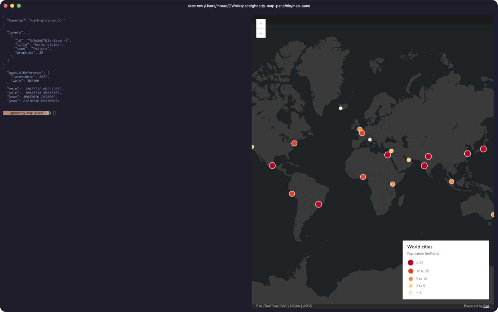
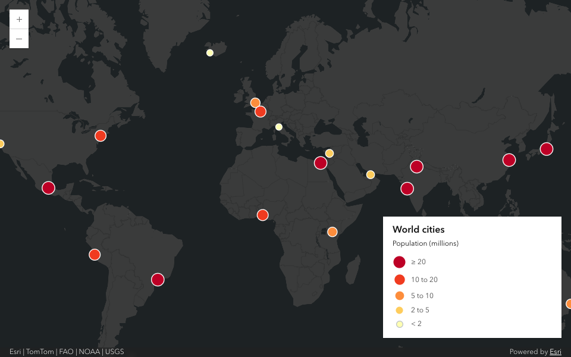
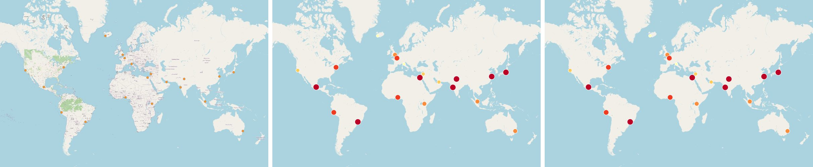
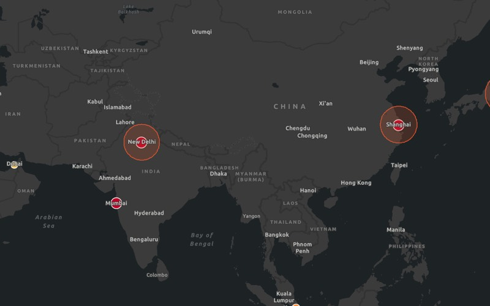

# I Gave My AI Coding Assistants a Map

> LinkedIn article draft. Cover image: `img/ghostty-split.jpg`. Images do not paste into LinkedIn: upload each image where it appears below.

Many people now write software with an AI assistant. You type a request in plain words, and the assistant writes and runs the code. Claude Code, Codex and Pi are three of these assistants. They work in a terminal: a text window where you type commands and read the answers.

I work with maps. A terminal shows text, and a map is a picture. When my assistant loaded data about cities or roads, I could not see the result. I had to stop, open other software and look there.

So I built map-pane. It puts a live map next to the assistant. The assistant can move the map, add data and change colors. I see each change at the moment it happens.

*Left: the commands and their answers. Right: the live map.*

## What you can ask

You talk to the assistant in plain words. These are real requests:

- "Go to Kuwait City."
- "Add the world cities and color them by population."
- "Show only the cities with more than 10 million people."
- "Draw a 300 km circle around the three largest cities."
- "Take a picture of the map."

The assistant turns each request into a short command and sends it to the map. The map answers with the result: the place it found, the name of the new layer, or an error. The assistant reads that answer and decides the next step. If a step fails, it can correct its work and try again.

*World cities, colored by population. The legend shows what each color means.*

The map uses the ArcGIS Maps SDK for JavaScript, the same mapping software that many web maps use. So the assistant can use data that already exists: map services, public data files and items from an ArcGIS account.

## How it works, in plain words

map-pane has three parts.

**The map page.** This is a web page that shows the map. It can show in the terminal, beside the assistant, or in a normal web browser. Many copies can be open at the same time.

**The bridge.** This is a small program that runs on your computer. It takes each command and sends it to every open map page.

**The command tool.** The assistant uses this tool to send a command to the bridge.

The bridge also keeps a list of every change to the map, in order. When you open a new map page, the bridge sends it the full list. The new page then shows the same map as the other pages. So you can start in the terminal, open the same map in your browser, and both show the same thing.

## One map for three assistants

Claude Code, Codex and Pi are made by different companies. Each one has its own way to add new skills. I did not want three versions of the same tool.

The solution is simple: the map has one command tool, and every assistant can run commands. I wrote one set of instructions (a "skill") that teaches the commands. All three assistants read the same instructions.

To test this, I gave the same task to all three: go to a city, add the cities, color them by population, and take a picture. These are their three pictures.

*Left: Claude Code added the cities in one color. Middle and right: Codex and Pi colored them by population.*

## When the commands are not enough

A fixed list of commands cannot cover every question. "Which city in view is the largest?" or "Draw a 300 km circle around these cities" needs more than a command.

For these questions, the assistant can write a small program and run it inside the map page. The program can read the data, calculate and draw. The answer comes back to the assistant as text.

*The assistant wrote the code for these 300 km circles and ran it in the map.*

## Safety

The map runs only on your own computer. It does not accept commands from other websites, and no outside server sends it commands.

The programs that the assistant runs inside the map are not in a protected box. If you sign in to your ArcGIS account, such a program can use your sign-in. Data from an unknown source can contain hidden instructions to the assistant. My rule is simple: do not sign in when you load data that you do not trust.

## What it does not do

- It runs on a Mac only, for now.
- It does not keep the map after you close it. You can save the map to your ArcGIS account.

## Try it

The project is free and open source: https://github.com/mraad/map-pane

The technical write-up, with the commands and the code, is on my blog: https://thunderheadxpler.blogspot.com/2026/11/map-pane-one-live-map-for-claude-code.html

If you work with maps and AI assistants, I want to know what you ask your map first.

#GIS #ArcGIS #AI #AIAgents #ClaudeCode #Codex #Geospatial #OpenSource
