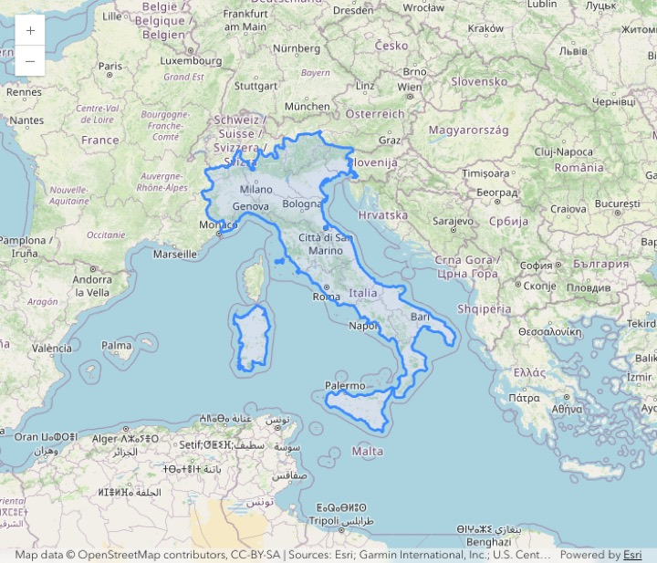

# Use map-pane as a Claude Code mod

The `mappane/` folder is a [Claude Code mod](https://code.claude.com/docs/en/plugins/mods/overview):
a plugin with a hooks module. It gives Claude tools that change a live map.
It shows the map in a Claude Code side pane, or in a browser window.



## 1. Requirements

| Item | Requirement |
|---|---|
| Claude Code | v2.1.287 or later (mods) |
| Operating system | macOS |
| Node.js | 24 or later. No npm packages. |
| Browser | Google Chrome. Set `CHROME` if Chrome is not in `/Applications`. |
| Terminal | A terminal that shows Claude Code pane pictures: Ghostty, kitty, or iTerm2 |
| Network | Access to `js.arcgis.com` and the basemap tile servers |

A mod runs with your permissions inside Claude Code. Read the code before you install it.

## 2. Install

1. Start Claude Code in a terminal.
2. Type `/plugin install mappane --marketplace mraad/map-pane`.
3. Type `y` to add the marketplace. Then select a scope.

From a shell:

```sh
claude plugin install mappane --marketplace mraad/map-pane
```

## 3. Show the map

| Command | Result |
|---|---|
| `/map` or `/map pane` | Opens the map in the side pane. |
| `/map browser` | Opens the map as a Chrome app window on the right half of the screen. |
| `/map basemap <name>` | Changes the basemap at once, with no model turn. |
| `/map clear` | Removes all layers and graphics at once. The basemap goes back to the start basemap. The view stays. |
| `/map stop` | Stops the bridge, its Chrome, the pane and the browser window. `/map` starts them again with the same map. |

Any browser can also open the map at `http://127.0.0.1:8765/`. Use `127.0.0.1`, not `localhost`.

In the pane:

- Drag to pan the map.
- Use the mouse wheel, a double-click or the zoom buttons to zoom.
- Click the map once. Then the arrow keys and `+` and `-` work.

The pane header shows the connection, the number of layers, the zoom and the layer titles.
The status line shows `map: <n> layers`, `map: no tab` or `map: off`.

If a tool call finds no open map page, the mod opens the pane and sends the call again.

## 4. Ask Claude

Examples:

- "Go to Kuwait City."
- "Add examples/cities.parquet as a layer and color it by order."
- "Put a blue point on Florence with the label 'start'."
- "Filter the Cities layer to population over 10 million."
- "Load https://example.com/data.gpkg."
- "Take a screenshot of the map."

Claude calls `screenshot` only when you ask for a picture. The other tools answer with the map state.

## 5. Tools

All tools have the prefix `mcp__mappane__`.

| Tool | Arguments | Result |
|---|---|---|
| `add_graphic` | `geometry` (GeoJSON, WGS84), `layer`, `symbol`, `attributes`, `popupTitle` | Adds one graphic to a graphics layer. Makes the layer if it is missing. Graphics layers have no legend entry. |
| `add_layer` | `type`, `url`, `urls`, `path`, `data`, `itemId`, `title`, `renderer`, `definitionExpression`, `labelingInfo`, `opacity`, `zoomTo` | Adds a layer and zooms to it. Types: `feature`, `geojson`, `csv`, `parquet`, `tile`, `vector-tile`, `imagery`, `map-image`, `portal-item`. `path` is an absolute local file. `data` is inline GeoJSON. A FeatureServer root URL adds all its layers. |
| `add_geopackage` | `url` or `path`, `table` | Adds the vector tables of a GeoPackage, one layer each. A table with one geometry type gets a legend entry and popups. |
| `update_layer` | `id` (id or title), `title`, `renderer`, `definitionExpression`, `labelingInfo`, `opacity`, `visible` | Changes a layer in place. A property that the layer does not have is an error. |
| `remove_layer` | `id` | Removes a layer. |
| `clear_graphics` | `layer` | Removes the graphics of one graphics layer, or of all of them. |
| `go_to` | `location`, or `center` and `zoom`, or `layerId` | Moves the map. `location` is a place or an address. The World Geocoding service finds it. The answer has the matched address and score. |
| `set_basemap` | `basemap` | Changes the basemap. See [Basemaps](#6-basemaps). |
| `screenshot` | `width`, `height` | Saves a PNG and answers its path. |
| `save_webmap` | `title` | Saves the map as a private web map item. Needs a sign-in. See [Sign in](#7-sign-in). |
| `map_state` | none | Answers the layers, the center and the zoom. |

Renderers, symbols and label classes use SDK autocast JSON. Example renderer:

```json
{"type":"class-breaks","field":"pop","classBreakInfos":[{"minValue":0,"maxValue":10,"symbol":{"type":"simple-marker","color":"#fecc5c"}}]}
```

## 6. Basemaps

- No key or sign-in: `osm`, `dark-gray`, `light-gray`, `imagery`, `topo`, `streets` (raster tiles), and the legacy ids that `bin/map-command basemaps` lists, for example `satellite` or `gray-vector`.
- Basemap styles, for example `arcgis/navigation`: these need a sign-in, or the page opened with `?apiKey=<key>`. Without one, `set_basemap` refuses them at once.
- A basemap that fails to load leaves the previous basemap in place.

## 7. Sign in

The mod has no sign-in tool. The sign-in opens a browser and waits up to 5 minutes, so it runs in a shell.
The CLI and the mod drive the same map, so a sign-in from the shell applies to the mod's map.

1. Register the redirect URI `http://127.0.0.1:8766/` on your OAuth client ID.
2. In a shell, go to the plugin folder. For an installed plugin, find it with `claude plugin list`.
3. Type `bin/map-command login --client-id <client-id>`. Add `--portal-url <url>` for a portal other than `https://www.arcgis.com`.
4. Sign in on the page that opens.
5. Ask Claude for a basemap style, or to save a web map.

A save runs on one map page, even when both the pane and browser are open. It keeps filters on local feature layers. If that page disconnects while saving, check the portal before retrying: the item may already exist.

The token stays in the open map pages and in bridge memory. It is not saved with the map.
Pages that open later get it from the bridge. After a bridge restart, sign in again.

## 8. The saved map

- The bridge keeps a log of the map changes. It replays the log to each page that opens or reconnects. All pages show the same map, with the same layer ids.
- The log is saved for each Claude Code session in `~/.claude/map-pane/sessions/<session id>/`, with inline data and screenshots. A mod reload or `claude --resume` shows the map again.
- `/clear` and `/resume` restart the bridge with the new session's map. After `/clear` the map is empty.
- Session folders not used for 30 days are deleted when the bridge starts.
- `go_to`, `screenshot`, `zoom`, `login` and `save_webmap` do not go into the log.

## 9. Options

| Variable | Default | Meaning |
|---|---|---|
| `CHROME` | `/Applications/Google Chrome.app/Contents/MacOS/Google Chrome` | Chrome binary |
| `MAP_PANE_BASEMAP` | `osm` | Start basemap (a legacy id) |
| `MAP_PANE_CENTER` | none | Start center, `latitude,longitude` |
| `MAP_PANE_ZOOM` | `3` | Start zoom, 0 to 23. Needs `MAP_PANE_CENTER`. |
| `MAP_PANE_EXTENT` | the world | Start extent, `xmin,ymin,xmax,ymax` in longitude and latitude |
| `MAP_PANE_TIMEOUT_MS` | `15000` | Command timeout. Adding data waits 60 s. |
| `MAP_PANE_IDLE_MS` | `90000` | The pane's Chrome stops after this time with no pane input. |

Set the variables before you start Claude Code. The mod passes its environment to the bridge.

## 10. Limits

- One mod map for each computer: the mod bridge uses port 8765. A second Claude Code session cannot start its bridge. Its status line shows `map: off`, and its tools say why.
- The pane assumes terminal cells with a 1:2 width to height ratio.
- `/map browser` uses the right half of the focused screen, not the real Ghostty window.
- New layers always go on top. There is no reorder tool.
- The log only grows. A removed layer stays in it as an add and a remove.

## 11. Troubleshooting

| Symptom | Cause | Action |
|---|---|---|
| `map: off`, tools say "port 8765 is held" | Another Claude Code session has the map. | Close the map in that session (`/map stop`). Then type `/map` here. |
| "wrong bridge token" | The bridge belongs to another session. | Same as above. |
| The pane says "The map could not start" | Chrome crashed 3 times. | Examine `CHROME`. Type `/map stop`, then `/map`. |
| Chrome cannot start at its configured path | Missing binary or an incorrect `CHROME` path | Correct `CHROME` and restart the map. The bridge reports the startup error and stays running. |
| The pane is blank | No access to `js.arcgis.com`. | Open `http://127.0.0.1:8765/` in a browser and examine the console. |
| "needs a sign-in" | A basemap style or `save_webmap` with no token | Do [Sign in](#7-sign-in). |

## 12. Develop the mod

```sh
git clone https://github.com/mraad/map-pane.git && cd map-pane
claude --plugin-dir ./mappane
```

A dev-mod session loads a copy at `~/.claude/dev-mods/<session-id>/mappane/`. After an edit, sync it:

```sh
rsync -a --exclude .claude-plugin/types mappane/ ~/.claude/dev-mods/<session-id>/mappane/
```

The mod reloads when the turn ends. The reload restarts the bridge, and the bridge replays the saved map.

Checks:

```sh
claude plugin validate mappane
claude plugin test mappane                 # hooks: tools, pane, bridge lines, /map
node --test mappane/web/                   # bridge and pane viewer (the Chrome test needs network)
npx -p typescript tsc -p mappane           # needs engine types from a loaded dev-mod copy
```

Architecture: [architecture.md](architecture.md).
