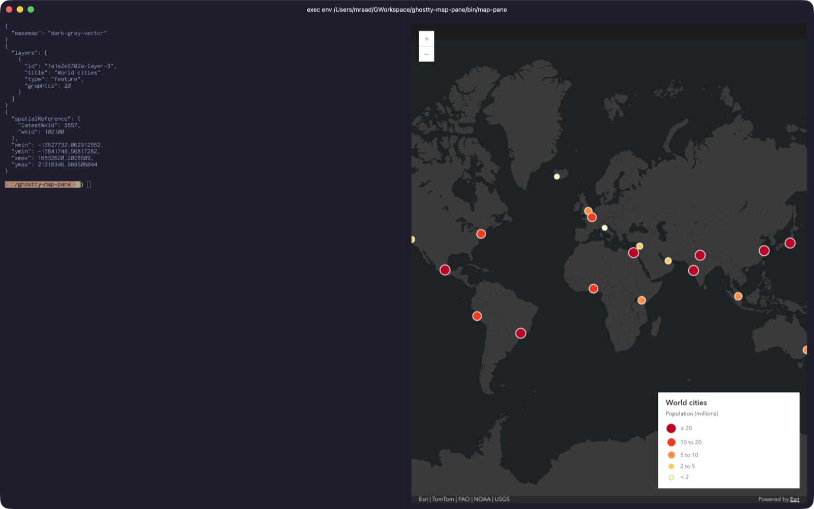

# Use map-pane standalone: Ghostty, Codex and Pi

Standalone, the map runs without the Claude Code mod.
`mappane/bin/map-pane` shows the map in a terminal with Kitty graphics, for example in a Ghostty split.
`mappane/bin/map-command` changes the map from any shell.
The `map-pane` skill tells Codex, Pi or Claude Code how to use the CLI.



All paths in this guide start at the repository folder.

## 1. Requirements

| Item | Requirement |
|---|---|
| Operating system | macOS. `--split` uses AppleScript. |
| Terminal | Ghostty 1.4 or later for `--split`. The pane works in any terminal with Kitty graphics and SGR pixel mouse. |
| Node.js | 24 or later. No npm packages. |
| Browser | Google Chrome, or `chrome-headless-shell`. Set `CHROME` if Chrome is not in `/Applications`. |
| Network | Access to `js.arcgis.com` and the basemap tile servers |

## 2. Start the map

1. Open a Ghostty terminal in the repository folder.
2. Type `mappane/bin/map-pane --split`.
3. On the first run, let macOS allow your terminal to control Ghostty.
4. Wait until the map shows in the new split. This takes approximately 5 seconds.
5. Type `mappane/bin/map-command extent`. The command prints the current view when the map is ready.

```sh
mappane/bin/map-pane --split   # open a split to the right of the terminal that ran it
mappane/bin/map-pane           # run in the current terminal
```

`mappane/bin/map-pane` first looks for a running map bridge of your user, for example the Claude Code mod's bridge.
If one answers, the pane shows that map. If none answers, the launcher starts a bridge on a free port.

## 3. Use the pane

| Input | Result |
|---|---|
| Drag | The map pans. |
| Mouse wheel | The map zooms. |
| Click | The page receives a click: zoom buttons, popups. |
| Arrow keys, `+`, `-`, text | The page receives the keys. |
| Ctrl+C | The pane stops. |

A zoom widget shows at the top left. The legend shows at the bottom right while the map has layers.

## 4. Stop the map

1. Click in the map split.
2. Push Ctrl+C.

The pane restores the terminal and stops its Chrome. If the launcher started the bridge, it stops the bridge too.
A bridge that was already running (for example the mod's) continues. Ghostty closes the split.

## 5. Map commands

Type the commands in a terminal other than the map split.
Each command prints JSON. A failed command prints an error and exits with status 1.

| Command | Result |
|---|---|
| `extent` | Prints the bounds and spatial reference of the view. |
| `clear` | Removes all layers. The basemap goes back to the start basemap. The legend hides. |
| `zoom [layer-id]` | Shows all layers, or one layer. |
| `remove <layer-id or title>` | Removes one layer. The other layers and the basemap stay. |
| `update-layer <layer-id or title> [--title <name>] [--renderer <JSON>] [--labels <JSON>] [--filter <SQL>] [--opacity <0-1>] [--visible true\|false]` | Changes one layer without reloading its data. Give at least one option. `--labels` turns labels on. `--filter` sets the SQL where clause (feature, GeoJSON, CSV and GeoParquet layers). |
| `go_to location <place or address>` | Finds a country, state, city, ZIP code or address with the World Geocoding service. Prints the match, the score and the extent. |
| `go_to coordinate <lat> <lon> [zoom]` | Centers on WGS84 degrees, latitude first. Keeps the zoom unless you give one (0 to 23). |
| `screenshot <file.png>` | Writes a PNG of the map. The PNG has no legend. |
| `basemaps` | Prints the basemap ids. Needs no running map. |
| `basemap <id>` | Sets the basemap. |
| `login [--portal-url <url>] [--client-id <id>] [--redirect-uri <uri>]` | Signs in to a portal. See [Sign in](#7-sign-in). |
| `save-webmap <title>` | Saves the map as a private web map item. Needs `login`. |
| `map-service <url>` | Adds a MapServer. |
| `feature-service <url>` | Adds a FeatureServer. A root URL adds all layers. A numbered URL adds one. |
| `geojson <url>` | Adds GeoJSON from a URL. |
| `geopackage <url> [table]` | Adds the vector tables of a GeoPackage, one layer each. |
| `graphics <file \| - \| JSON> [--title <name>] [--renderer <file \| JSON>] [--labels <file \| JSON>]` | Adds GeoJSON from a file, standard input or inline JSON. |
| `--info` | Prints the page URL, process id and socket of the targeted map. |

Commands that add data do not move the view. Type `zoom` after them.

Examples:

```sh
mappane/bin/map-command basemap dark-gray-vector
mappane/bin/map-command go_to location "Austin, Texas"
mappane/bin/map-command go_to coordinate 30.2672 -97.7431 12
mappane/bin/map-command feature-service https://sampleserver6.arcgisonline.com/arcgis/rest/services/Wildfire/FeatureServer
mappane/bin/map-command geojson https://earthquake.usgs.gov/earthquakes/feed/v1.0/summary/all_day.geojson
cat features.geojson | mappane/bin/map-command graphics - --title Features
mappane/bin/map-command graphics examples/cities.geojson --title "World cities" --renderer examples/population-renderer.json
mappane/bin/map-command zoom
mappane/bin/map-command screenshot map.png
```

### The legend

- The legend lists layers that have a renderer.
- `graphics` and `geopackage` make a client-side FeatureLayer when all features have one geometry type. It has a legend entry and popups.
- Mixed geometry types make a GraphicsLayer. It has no legend entry, and it refuses `--renderer` and `--labels`.

### Color features by a value

1. Put the value in a GeoJSON property. You can calculate it first, for example in SQL.
2. Write a renderer in SDK autocast JSON (class-breaks or unique-value).
3. Set the renderer `field` to the safe field name. See the rule below.
4. Type `graphics` with `--title` and `--renderer`. The title is the legend heading.
5. Type `zoom`.

<a id="safe-field-names"></a>
**Safe field names.** Each property name becomes a safe field name.
Each character outside ASCII letters, digits and `_` becomes `_`.
For example, `population (millions)` becomes `population__millions_`.
A name that starts with a digit gets an initial `_`. An empty name becomes `field`.
The name `__oid` is reserved. Underscores are added until each name is unique.
Properties with only null values make no field. The alias keeps the original name.
A property with only numbers becomes a `double` field. Other properties become `string` fields.

## 6. Basemaps

`basemaps` prints two lists:

- `legacy`: 16 ids that work with no sign-in, for example `osm`, `satellite`, `dark-gray-vector`.
- `styles`: 78 basemap style ids, for example `arcgis/navigation`. These need `login`.

The keyless raster basemaps `dark-gray`, `light-gray`, `imagery`, `topo` and `streets` also work.
A basemap that fails leaves the current basemap in place.

## 7. Sign in

`login` uses OAuth 2.0 with an authorization code and PKCE. The client ID needs no secret.
The map pages keep the token and refresh it. The CLI never prints it, and the bridge never saves it.

1. In the portal, open the OAuth credentials of your app.
2. Add the redirect URI `http://127.0.0.1:8766/`.
3. Set `MAP_PANE_CLIENT_ID`, or use `--client-id`.
4. Set `MAP_PANE_PORTAL_URL`, or use `--portal-url`. The default is `https://www.arcgis.com`.
5. Start the map.
6. Type `mappane/bin/map-command login`.
7. Sign in on the page that opens. You have 5 minutes.

```sh
MAP_PANE_CLIENT_ID=<client-id> mappane/bin/map-command login
mappane/bin/map-command basemap arcgis/navigation
```

- `login` prints the sign-in URL on standard error. Open it yourself if no browser opens.
- Only one `login` can wait at a time, because it listens on port 8766. Use `--redirect-uri` or `MAP_PANE_REDIRECT_URI` for another loopback port.
- Pages that open later get the sign-in from the bridge. After a bridge restart, sign in again.
- A save runs on one page and keeps filters on local feature layers. If that page disconnects while saving, check the portal before retrying: the item may already exist.

## 8. Agents

The repository has one skill, `.agents/skills/map-pane/SKILL.md`. Install it once, and it works from any folder.
The skill runs the CLI by its absolute path, so the agent can work in your own project.

| Agent | Install |
|---|---|
| Codex | `codex plugin marketplace add mraad/map-pane`, then `codex plugin add map-pane@map-pane` |
| Pi | `pi install git:github.com/mraad/map-pane` |

From a local clone, use its path instead: `codex plugin marketplace add /path/to/map-pane` or `pi install /path/to/map-pane`.
A local Pi install loads the clone in place. A local Codex install copies it: after a change, run `codex plugin add map-pane@map-pane` again.

Without an install, start the agent in the repository folder: Codex and Pi find `.agents/skills/`,
and Claude Code finds `.claude/skills/map-pane`, a link to the same folder.

Ask with the skill prefix, or in plain words:

| Agent | Example |
|---|---|
| Codex | `$map-pane go_to location Austin, Texas` |
| Pi | `/skill:map-pane go_to location Austin, Texas` |
| Claude Code (no mod) | `/map-pane go_to location Austin, Texas` |

The agent needs shell access on the same computer, as the user who runs the map.
An agent can query data (for example with DuckDB), write GeoJSON and a renderer, and send them with `graphics`.

### Codex

The Codex `workspace-write` sandbox blocks the map socket with `connect EPERM`. Allow it:

```sh
codex exec -s workspace-write -c sandbox_workspace_write.network_access=true '$map-pane list the basemaps'
```

The same setting lets `login` listen on its loopback redirect and reach the portal.
`login` waits up to 5 minutes. Give the agent a shell timeout of at least 300 seconds.

### Pi

1. Start Pi in the repository folder.
2. Accept the trust prompt for the repository.
3. If Pi does not list the skill, type `/reload`.

Pi needs its provider credentials in its environment. Start it from a shell that has them.

### Claude Code

With the `mappane` mod loaded, Claude uses the mod's tools. See [mod.md](mod.md).
Without the mod, Claude uses the skill and the CLI, like Codex and Pi.

### Tested

On 2026-11-17, each agent ran the same task on a live map: geocode Austin, Texas, add `examples/cities.geojson`, save a screenshot.

| Agent | Path | Result |
|---|---|---|
| Codex CLI 0.169.0 | skill + CLI, `workspace-write` with network access | Austin matched (score 100), 20 features with the population renderer, [screenshot](img/proof-codex.png) |
| Pi 1.3.0 | skill + CLI | Same result, [screenshot](img/proof-pi.png) |
| Claude Code (mod, `claude -p --plugin-dir ./mappane`) | `mcp__mappane__go_to`, `add_layer`, `screenshot` | Austin matched (score 100), layer added, [screenshot](img/proof-claude.png) |

Codex and Pi also ran the task from an unrelated folder after an install (plugin and package), each with the CLI from its install path.

## 9. Several maps

The CLI sends each command to the newest bridge of your user.
To choose another map, set its socket on each command:

```sh
MAP_PANE_SOCKET="$(node -p 'require("os").tmpdir()')/map-pane-command-$(id -u)-<bridge-pid>.sock" mappane/bin/map-command extent
```

Each bridge can have many pages open (panes, browsers). All pages of one bridge show the same map.

## 10. Options

| Variable | Default | Meaning |
|---|---|---|
| `CHROME` | `/Applications/Google Chrome.app/Contents/MacOS/Google Chrome` | Chrome binary. `chrome-headless-shell` also works. |
| `MAP_PANE_DPR` | `2` | Terminal pixels for each CSS pixel. Use `1` on a display that is not Retina. |
| `MAP_PANE_BASEMAP` | `osm` | Start basemap. A legacy id only. |
| `MAP_PANE_CENTER` | none | Start center, `latitude,longitude` |
| `MAP_PANE_ZOOM` | `3` | Start zoom, 0 to 23. Needs `MAP_PANE_CENTER`. |
| `MAP_PANE_EXTENT` | the world | Start extent, `xmin,ymin,xmax,ymax` in longitude and latitude. Overrides center and zoom. |
| `MAP_PANE_SOCKET` | the newest bridge | The bridge that `map-command` uses |
| `MAP_PANE_PORTAL_URL` | `https://www.arcgis.com` | Portal for `login` |
| `MAP_PANE_CLIENT_ID` | none | OAuth client ID for `login` |
| `MAP_PANE_REDIRECT_URI` | `http://127.0.0.1:8766/` | Loopback redirect for `login` |
| `PORT` | `0` (a free port) | Port of a bridge that the launcher starts |

`--split` sends `CHROME`, `MAP_PANE_DPR` and the four start-view variables to the new split.
The start-view variables apply only to a bridge that the launcher starts. A bad value stops the launcher.

## 11. Data rules and limits

| Subject | Rule |
|---|---|
| GeoJSON | WGS84 (RFC 7946). A `crs` member is an error. Polygon ring order is corrected. |
| Failed layers | The page loads a layer before it adds it. A layer that fails does not change the map. |
| GeoPackage | Each vector table is a layer. EPSG or WKT and Z are kept; M is dropped. Raster tiles, curves and undefined coordinate systems are refused. 64 MiB and 100,000 features at most. |
| Deadlines | 15 s for each command; 60 s to add data, `graphics` and `save-webmap`; 30 s for `zoom` and `screenshot`; 30 s each for a GeoPackage download and conversion. |
| Services | A service must allow browser CORS access. |
| Repeats | Commands that add data are not idempotent. Examine the map before you repeat a command that timed out. |

## 12. Known limits

- Frames have CSS resolution. On a Retina display, map text is softer than in a browser.
- Each frame is a full PNG. This is correct for a local terminal, not for a slow SSH connection.
- The pane sends arrow keys, Enter, Backspace, Tab, Escape and printable text. It does not send function keys or Control and Alt combinations.
- Headless Chrome draws no pointer. Ghostty shows its own pointer.

## 13. Troubleshooting

| Symptom | Cause | Action |
|---|---|---|
| `cannot start Chrome at …` | Chrome is not at the default path. | Set `CHROME`. |
| The pane is blank. | No access to `js.arcgis.com`. | Type `npm run serve`. Open the URL in a browser and examine the console. |
| `--split` does nothing. | macOS refused the automation permission. | System Settings, Privacy & Security, Automation: allow your terminal to control Ghostty. |
| `No running map found` | No bridge, or another `TMPDIR`. | Start `mappane/bin/map-pane --split`, or set `MAP_PANE_SOCKET`. |
| `No map page is open` | The bridge runs, but no page shows the map. | Start `mappane/bin/map-pane --split`, or open the `--info` URL in a browser. |
| `needs a sign-in` | A basemap style or `save-webmap` with no token | Type `mappane/bin/map-command login`. |
| `Port 8766 is busy` | Another `login` waits. | Finish it, or use `--redirect-uri`. |
| `connect EPERM` in Codex | The sandbox blocks the socket. | Add `-c sandbox_workspace_write.network_access=true`. |
| `A renderer needs features of one geometry type` | Mixed geometry types | Split the GeoJSON by geometry type. |
| The terminal is incorrect after a crash. | The pane did not restore it. | Type `reset`. |
